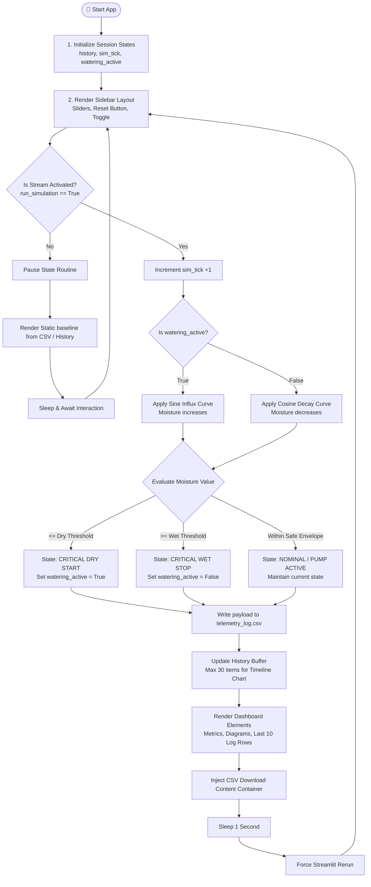
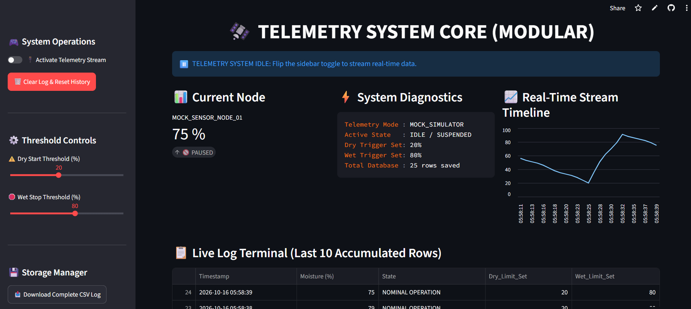

# 🛰️ Telemetry System Core (Dynamic Control)

An advanced, real-time **Streamlit telemetry dashboard** designed to monitor, simulate, and control soil moisture nodes dynamically. The application acts as a state machine, utilizing custom threshold boundaries configured via a live sidebar to manage mock actuator behaviors while persistently logging historical streams to local disk infrastructure.

---

## 📁 Repository Structure
```text
├── app.py             # Main entry point & Dashboard Grid Layout
├── simulation.py      # Mathematical wave calculations & safe boundaries
├── storage.py         # CSV file I/O & chronological memory limits
├── telemetry_log.csv  # Local transactional runtime log (auto-generated)
└── images/
    └── dashboard_preview.png  # Live telemetry interface screenshot

```

## 🏗️ System Logic Flow Architecture

The following sequence flowchart illustrates how the system processes states, manages the infinite loop criteria, applies slider parameters, and commits transactional records to storage.



---

## ⚡ Core Functional Enhancements

* **Dynamic Boundary Tracking:** Modifying the `Dry Start` or `Wet Stop` sliders immediately changes the runtime state criteria without resetting the active runtime matrix.
* **Persistent Disk Storage:** Automatically reads and appends streaming logs to `telemetry_log.csv`, protecting historical data across hard script restarts.
* **Dynamic Delta Analysis:** Computes and highlights moisture movement flags (`🌊 INCREASING` or `🍂 DECREASING`) inside native visual anchors.
* **Memory Management Windows:** Restricts chart rendering objects to the last 30 memory indices to eliminate frontend engine lag over infinite uptime runs.

---

## 🚀 Quick Setup & Runtime

### 1. Install System Dependencies
Ensure you have Python 3.8+ installed along with the required analytical and streaming libraries:
```bash
pip install streamlit pandas
```

### 2. Launch the Application Core
Execute the script via your local terminal command interface:
```bash
streamlit run app.py
```
*(Replace `app.py` with the exact filename where your code is saved).*
---

## 🖼️ Interface Previews


*Figure 1: Modular telemetry dashboard stream showing node metrics, diagnostic status tracking, timeline chart plots, and live disk log terminals.*

---
### 3. File Outputs
The script generates a local file named `telemetry_log.csv` in the execution root directory. You can clean this file manually or click the **🗑️ Clear Log & Reset History** button on the UI sidebar to wipe current tables.
